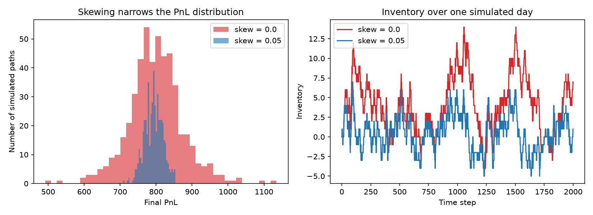
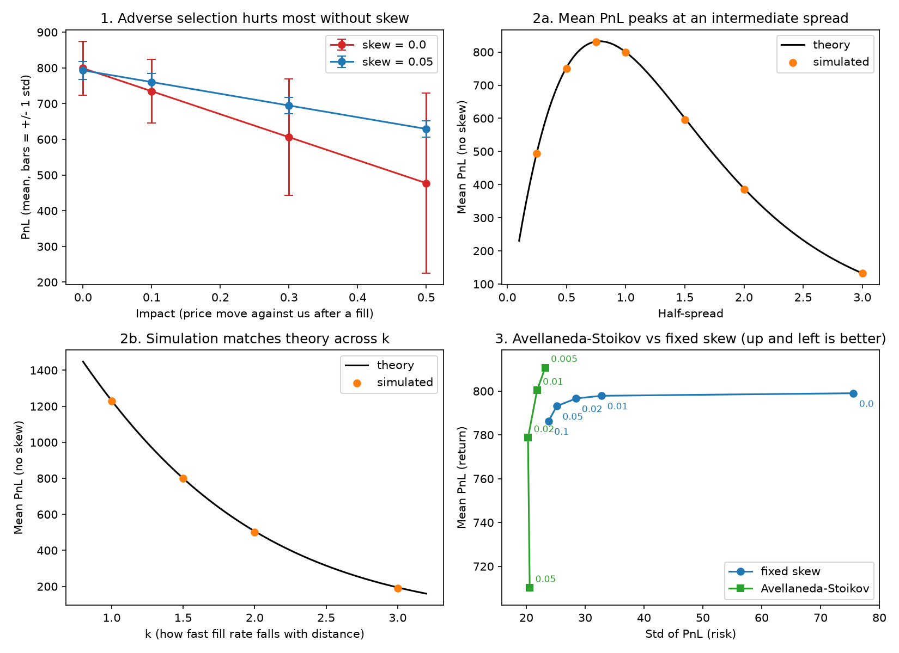

# Toy market maker: does inventory skewing reduce risk?

A small Python simulation of a market maker quoting a bid and an ask around a
random-walk price. Fills arrive as a Poisson process whose rate falls
exponentially with the quote's distance from the mid price. The market maker
shifts both quotes against its inventory ("skew") to push inventory back to zero.

Questions investigated:
1. Does skewing reduce risk, and what does it cost?
2. How does adverse selection (price moving against us after a fill) change this?
3. What spread maximises expected PnL, and does the simulation match theory?
4. How does the Avellaneda-Stoikov closed-form strategy compare with a fixed skew?

## Key findings

- Skewing quotes against inventory cut the standard deviation of PnL by about
  two thirds for under 1% of mean PnL.
- Adverse selection hurts much more without skewing: at impact 0.5, mean PnL
  fell 40% with no skew but only 21% with skew 0.05.
- The simulation matches the closed-form expected PnL at every spread and k
  tested, and the best spread is an intermediate one, not the widest.
- Under adverse selection the best spread widens (0.75 with no impact, about
  1.0 with impact 0.3).
- Avellaneda-Stoikov quotes beat the best fixed skew on risk and return in this
  model, which is the model they were derived for.

## Files

| file | what it does |
|------|--------------|
| `market_maker.py` | the simulation and all experiments (run it to print every table below) |
| `plot.py` | draws the figures; set `SAVE = True` to write the PNGs |
| `results.png`, `extensions.png` | figures shown in this README |

## Result

1,000 simulated paths of 2,000 steps, half-spread 1.0:

| skew | mean PnL | std PnL | avg max abs inventory |
|-----:|---------:|--------:|----------------------:|
| 0.00 | 799.8 | 82.3 | 31.2 |
| 0.05 | 795.0 | 26.8 | 7.6 |

Skewing cut the standard deviation of PnL by about two thirds and the typical
peak inventory by about three quarters, for under 1% of mean PnL.

## Model

- Mid price is a Gaussian random walk (sigma = 0.1 per step).
- Fill rate on each side = A * exp(-k * distance from mid), with A = 1, k = 1.5.
  Probability of a fill in one step = 1 - exp(-rate).
- One unit per fill. Inventory marked to mid at the end.
- Quotes: bid = mid - half_spread - skew * inventory,
  ask = mid + half_spread - skew * inventory.

## Extensions

### 1. Adverse selection
After a fill, the price moves against us by `impact` (down after we buy, up
after we sell). Half-spread 1.0:

| impact | mean PnL, skew 0 | std, skew 0 | mean PnL, skew 0.05 | std, skew 0.05 |
|-------:|-----------------:|------------:|--------------------:|---------------:|
| 0.0 | 799.8 | 82.3 | 795.0 | 26.8 |
| 0.1 | 735.2 | 94.0 | 762.1 | 26.1 |
| 0.3 | 606.0 | 160.8 | 696.5 | 24.8 |
| 0.5 | 476.7 | 245.0 | 630.8 | 23.6 |

Fill rates depend only on the distance of the quotes from mid, so impact does
not change the inventory path, only the prices it is valued at. Skewing keeps
inventory small, and the damage from adverse selection is much smaller with
skew than without it.

### 2. Spread and k sweeps (skew 0)
With no skew, expected PnL is about `n_steps * 2 * half_spread * p`, where
`p = 1 - exp(-A * exp(-k * half_spread))`.

| half-spread | simulated | theory |
|------------:|----------:|-------:|
| 0.25 | 498.0 | 497.1 |
| 0.50 | 753.5 | 753.0 |
| 0.75 | 833.6 | 831.7 |
| 1.00 | 799.8 | 800.0 |
| 1.50 | 598.0 | 600.2 |
| 2.00 | 387.8 | 388.5 |
| 3.00 | 132.9 | 132.6 |

| k | simulated | theory |
|--:|----------:|-------:|
| 1.0 | 1233.3 | 1231.2 |
| 1.5 | 799.8 | 800.0 |
| 2.0 | 504.2 | 506.3 |
| 3.0 | 193.2 | 194.3 |

The simulation agrees with the formula, which is a check that the code is
correct. Mean PnL peaks at an intermediate spread: wider quotes earn more per
fill but get filled much less often.

With adverse selection (impact 0.3, 300 paths, no skew) the best spread moves
out, because each fill now costs something:

| half-spread | mean PnL, impact 0 | mean PnL, impact 0.3 |
|------------:|-------------------:|---------------------:|
| 0.50 | 747.6 | 459.2 |
| 0.75 | 826.7 | 587.2 |
| 1.00 | 800.4 | 606.7 |
| 1.25 | 707.9 | 572.6 |
| 1.50 | 597.9 | 496.8 |
| 2.00 | 388.2 | 333.1 |

### 3. Avellaneda-Stoikov
Quotes are centred on `mid - inventory * gamma * sigma^2 * (T - t)` with total
spread `gamma * sigma^2 * (T - t) + (2 / gamma) * ln(1 + gamma / k)`
(Avellaneda and Stoikov, 2008).

| strategy | mean PnL | std PnL | mean/std | avg max abs inventory |
|----------|---------:|--------:|---------:|----------------------:|
| fixed skew 0.05 | 795.0 | 26.8 | 29.65 | 7.6 |
| AS, gamma 0.005 | 812.2 | 24.5 | 33.20 | 11.4 |
| AS, gamma 0.01 | 801.5 | 22.9 | 35.01 | 9.5 |
| AS, gamma 0.02 | 779.6 | 21.7 | 36.00 | 7.9 |
| AS, gamma 0.05 | 711.0 | 21.5 | 33.05 | 6.2 |

With gamma = 0.005, AS had both higher mean PnL and lower PnL standard deviation
than the fixed skew. Gamma = 0.02 had the best mean/std ratio. Larger gamma
means more risk aversion: lower inventory, lower mean PnL.

## Limitations

- The price is a pure random walk, so fills carry no information except through
  the fixed `impact` jump in extension 1.
- Fill rates, A and k, are assumed rather than estimated from real order-book data.
- No fees, no latency, no queue position, no inventory limits, one unit per fill.
- Constant volatility. The mean/std ratio is a crude risk-adjusted measure over
  one simulated day, not an annualised Sharpe ratio.
- The results show what follows from these assumptions. They are not evidence
  that the strategy would make money in a real market.

## Run it

    pip install numpy matplotlib
    python market_maker.py     # all experiments, about 2 minutes (lower N for speed)
    python plot.py             # opens the figures (about 1 minute)

Requires Python 3 with numpy and matplotlib. Set `SAVE = True` in `plot.py` to
write the PNGs next to the script. Results use fixed random seeds, so reruns give
the same numbers. The figures use 500 paths per point and the tables use 1,000,
so small differences between them are sampling noise.

## Reference

Avellaneda, M. and Stoikov, S. (2008). High-frequency trading in a limit order
book. Quantitative Finance, 8(3), 217-224.
